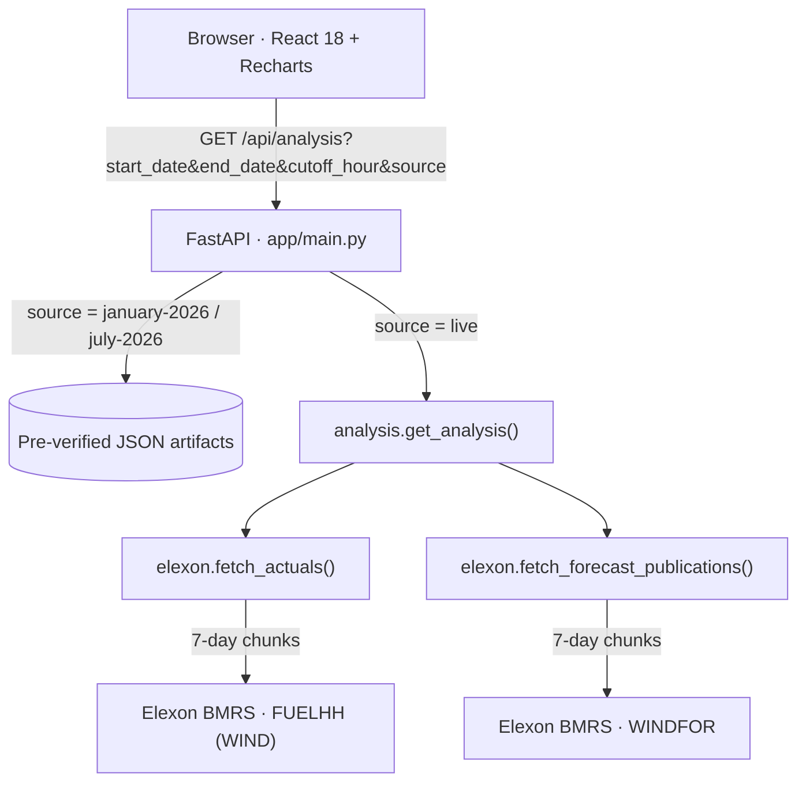

# WindScope UK · Day-Ahead Wind Forecast Intelligence

> **Know what the wind forecast was when you had to decide, and how wrong it tends to be.**
> An auditable forecast-vs-outturn accuracy platform for Great Britain's day-ahead electricity market, built on public Elexon BMRS data.


---

## 🔗 Submission Links

| Item | Link |
| :--- | :--- |
| 🌐 **Live App (Frontend)** | https://gridbricks-alpha.vercel.app/ |
| ⚙️ **Live Backend API** | https://windscope-backend-pl3o.onrender.com |
| ❤️ **Health Check** | https://windscope-backend-pl3o.onrender.com/api/health |
| 🎬 **Video Demo (unlisted YouTube)** | `<ADD YOUTUBE URL>` |
| 📦 **Repository** | https://github.com/conqquest/gridbricks |

---

## Table of Contents

1. [The Problem & What This Solves](#1-the-problem--what-this-solves)
2. [Headline Results](#2-headline-results)
3. [Quickstart](#3-quickstart)
4. [Repository Structure](#4-repository-structure)
5. [Architecture & Data Flow](#5-architecture--data-flow)
6. [Methodology](#6-methodology)
7. [Code Reference](#7-code-reference)
8. [API Reference](#8-api-reference)
9. [Key Engineering Decisions](#9-key-engineering-decisions)
10. [Testing](#10-testing)
11. [Assumptions & Known Limitations](#11-assumptions--known-limitations)
12. [AI Tools Disclosure](#12-ai-tools-disclosure)

---

## 1. The Problem & What This Solves

A GB energy utility must buy power on the **day-ahead market** one day before delivery. To know how much extra (e.g. thermal) power to procure, the desk relies on **wind generation forecasts**, which are weather-dependent and imperfect. Forecast errors turn into imbalance cashout costs.

WindScope UK answers two questions for the trading desk:

| # | Question | How WindScope answers it |
| :-: | :--- | :--- |
| 1 | **What was the latest wind forecast available at decision time?** | Applies a configurable gate-closure cutoff (default **10:00 Europe/London on D-1**) and selects the *latest forecast published before it* for every delivery period. |
| 2 | **How accurate are these forecasts, quantitatively?** | Pairs each forecast with outturn actuals and reports **MAE, RMSE, signed bias, and WAPE**, overall and per day, with a full half-hourly audit ledger. |

**Data scope (Elexon BMRS only):** `WINDFOR` (day-ahead national wind forecast) and `FUELHH` (half-hourly actuals, `fuelType = WIND`).

---

## 2. Headline Results

Live Elexon data, cutoff **10:00 Europe/London on D-1**.

| Metric | **January 2026** (GMT, core deliverable) | July 2026 (BST, comparison) |
| :--- | :---: | :---: |
| Mean Absolute Error (MAE) | **2,126.12 MW** | 1,149.07 MW |
| Root Mean Square Error (RMSE) | **2,620.80 MW** | 1,609.07 MW |
| Mean Forecast Bias | **+1,840.30 MW** (over-forecast) | +816.37 MW (over-forecast) |
| Weighted Error (WAPE) | **18.36%** | 20.62% |
| Matched Settlement Periods | **1,488 / 1,488 (100%)** | 1,488 / 1,488 (100%) |
| Daily Integrity | 48 half-hours on all 31 days | 48 half-hours on all 31 days |

**Takeaway for the desk:** in January 2026 the day-ahead forecast systematically **over-estimated** wind by roughly 1.8 GW on average. A buyer who trusted it blindly would have under-procured thermal cover. The quantified bias and error lets the desk apply a data-driven safety margin.

July is included to show the pipeline handles the **BST clock change** correctly.

---

## 3. Quickstart

### Option A: One-command Docker (recommended)

```bash
git clone https://github.com/conqquest/gridbricks.git
cd gridbricks
docker compose up --build
```

| Service | URL |
| :--- | :--- |
| Web dashboard | http://localhost:5173 |
| API health | http://localhost:8000/api/health |
| OpenAPI docs | http://localhost:8000/docs |

Stop with `docker compose down`.
(You can equally run `docker compose up --build` from inside `windscope-uk-starter/`.)

### Option B: Run locally without Docker

**Prerequisites:** Python 3.11+, Node.js 18+, npm.

```bash
# Terminal 1 · Backend
cd windscope-uk-starter/backend
python3 -m venv .venv
source .venv/bin/activate
pip install -r requirements.txt
uvicorn app.main:app --reload --host 0.0.0.0 --port 8000
```

```bash
# Terminal 2 · Frontend
cd windscope-uk-starter/frontend
npm install
npm run dev
```

Open http://localhost:5173.

### Using the dashboard

Use the **one-click presets**:

| Preset | What it does |
| :--- | :--- |
| `live-january-core` | Live fetch of the full January 2026 benchmark from Elexon |
| `live-july-month` | Live fetch of July 2026 for BST comparison |
| `cached-january` | Instant pre-verified January snapshot (no network wait) |
| `cached-july` | Instant pre-verified July snapshot |

You can also set a custom date range and cutoff hour, switch between **Daily Breakdown** and **Half-hour Observations** tabs, and **export all observations to CSV**.

> ⏱️ Live queries run sequential 7-day chunked requests against Elexon, so a full month can take a while. Use the cached presets for instant results.

---

## 4. Repository Structure

```
gridbricks/
├── docker-compose.yml            # One-command fullstack startup
├── README.md
└── windscope-uk-starter/
    ├── backend/
    │   ├── app/
    │   │   ├── main.py                 # FastAPI routes: /api/health, /api/analysis
    │   │   └── services/
    │   │       ├── elexon.py           # Elexon BMRS client (chunking, fetching, dedup)
    │   │       └── analysis.py         # Cutoff filtering, pairing, metrics engine
    │   ├── tests/
    │   │   ├── test_elexon_actuals.py      # 21 tests
    │   │   ├── test_elexon_forecasts.py    # 21 tests
    │   │   ├── test_matching.py            # 28 tests
    │   │   └── test_metrics.py             #  2 tests
    │   ├── january-analysis.json       # Pre-verified January 2026 artifact
    │   ├── july-2026-analysis.json     # Pre-verified July 2026 artifact
    │   └── requirements.txt
    └── frontend/
        └── src/
            ├── App.jsx                         # Dashboard: state, fetching, charts, CSV export
            └── components/
                ├── WindScopeHeader.jsx         # Top navigation + live badge
                └── LandscapeFooter.jsx         # Illustrated SVG footer
```

---

## 5. Architecture & Data Flow



**Request lifecycle**

1. **Request:** the UI asks for a delivery date range and cutoff hour.
2. **Chunked ingestion:** Elexon rejects ranges over 7 days, so the backend splits the query into contiguous 7-day chunks, merges them, and fails loudly on any HTTP error (no silent partial data).
3. **Cutoff filtering:** drops every forecast published after the cutoff on D-1 (Europe/London).
4. **Snapshot selection:** for each delivery hour, keeps the *latest* eligible forecast.
5. **Resolution pairing:** maps the hourly forecast onto both 30-minute actuals (`:00`, `:30`).
6. **Aggregation:** computes overall and per-day (UK local date) MAE, RMSE, bias, WAPE.

---

## 6. Methodology

### 6.1 Gate-closure cutoff

Decisions for day **D** are modelled as made at **10:00 Europe/London on D-1** (configurable). Only forecasts with `publishTime <= cutoff` are eligible.

| Season | 10:00 local = | Fetch window starts |
| :--- | :--- | :--- |
| GMT (winter) | 10:00 UTC | 00:00 UTC on D-1 |
| BST (summer) | **09:00 UTC** | **23:00 UTC on D-2** (= 00:00 BST on D-1) |

The BST shift is why the fetch window is computed from local midnight, so early-morning publications are never missed.

### 6.2 Hourly → half-hourly pairing

- `WINDFOR` forecasts are **1-hour** values over `[T, T+1h)`.
- `FUELHH` actuals are **30-minute** values over `[T, T+30m)` and `[T+30m, T+1h)`.
- The hourly forecast is paired with **both** actuals. Actuals are **never averaged**, preserving the real half-hourly volatility that drives imbalance cost.

### 6.3 Metrics

Let `F` = forecast, `A` = actual, `n` = matched periods.

| Metric | Formula | Reading |
| :--- | :--- | :--- |
| **MAE** | `(1/n) Σ │F − A│` | Typical size of error, in MW |
| **RMSE** | `√((1/n) Σ (F − A)²)` | Like MAE but penalises large misses |
| **Bias** | `(1/n) Σ (F − A)` | Signed. **Positive = over-forecast** |
| **WAPE** | `Σ │F − A│ / Σ │A│ × 100%` | Error relative to total generation |

### 6.4 Daily grouping

Observations are grouped by **Europe/London delivery date, not UTC**, so each settlement day matches the GB regulatory calendar and contains exactly 48 half-hours (on non-clock-change days).

---

## 7. Code Reference

### Backend: `app/services/elexon.py` (API client)

| Function | Purpose |
| :--- | :--- |
| `_date_chunks(start, end, chunk_days)` | Yields inclusive `(chunk_start, chunk_end)` date pairs with no gaps or overlaps. Needed because `FUELHH` returns HTTP 400 for ranges over 7 days. |
| `_datetime_chunks(start_dt, end_dt, chunk_days=7)` | Yields contiguous UTC datetime pairs (chunk N's end = chunk N+1's start). Needed for `WINDFOR` publish-time queries, which have the same 7-day limit. |
| `_records(payload)` | Normalises BMRS JSON: returns `payload["data"]` for dicts, the list itself for arrays, `[]` if missing. |
| `_parse_datetime(value)` | Parses ISO-8601 (including `Z`) into timezone-aware UTC datetimes. |
| `fetch_actuals(start, end)` | Fetches `FUELHH` in 7-day chunks, calls `raise_for_status()` on any failure, keeps `fuelType == "WIND"`, returns `{startTime, actual}`. |
| `fetch_forecast_publications(start, end)` | Fetches `WINDFOR` from local midnight D-1 (converted to UTC) to midnight UTC after `end`, in 7-day chunks. De-duplicates on `(startTime, publishTime)`. Returns `{startTime, publishTime, forecast}`. |

### Backend: `app/services/analysis.py` (matching & metrics)

| Function | Purpose |
| :--- | :--- |
| `_metric_rows(rows)` | Scoring engine. Returns `matchedPeriods`, `maeMw`, `rmseMw`, `biasMw`, `wapePercent` (`None` when total actual is 0). |
| `get_analysis(start, end, cutoff_hour)` | Orchestrator: fetch → index actuals by UTC `startTime` → apply cutoff per delivery date → pick latest eligible snapshot → pair with `:00` and `:30` actuals → aggregate by UK date. Returns summary, daily breakdown, full observation ledger, and metadata. |

### Backend: `app/main.py` (routes)

| Function | Route | Purpose |
| :--- | :--- | :--- |
| `health()` | `GET /api/health` | Liveness probe for Docker and Render. Returns `{"status": "ok", "service": "windscope-uk-api"}`. |
| `analysis(...)` | `GET /api/analysis` | Main analysis endpoint (see [API Reference](#8-api-reference)). |

### Frontend: `src/App.jsx`

| Item | Purpose |
| :--- | :--- |
| `MetricCard` | KPI card with icon, status tag, and explicit `+` sign for positive bias. |
| `App` state | `data`, `loading`, `loadingMsg`, `error`, `start`/`end` (default 2026-01-01 to 2026-01-31), `cutoff` (default `"10"`), `activeTab` (`daily` / `observations`), `sourceMode` (`live` / `january-2026` / `july-2026`). |
| `loadData(...)` | Calls `${API}/api/analysis` via Axios with a **180 s timeout** to accommodate chunked live fetches. |
| `handleSelectPreset(preset)` | One-click switcher for the four presets. |
| `chartData` (`useMemo`) | Converts observations into Recharts points with Europe/London timestamps. |
| `downloadCsv()` | RFC-4180 export: `startTime_UTC, startTime_UK, publishTime_UTC, forecast_MW, actual_MW, error_MW`. |
| `scrollToSection(id)` | Smooth navigation between Overview, Analysis, Methodology, Data Sources. |

### Frontend: components

- **`WindScopeHeader.jsx`**: sticky blurred header with brand, nav links, `Live Elexon BMRS` badge, and refresh action.
- **`LandscapeFooter.jsx`**: editorial, woodblock-style SVG landscape plus Product / Resources / Company link columns.

---

## 8. API Reference

### `GET /api/health`
Returns `{"status": "ok", "service": "windscope-uk-api"}`.

### `GET /api/analysis`

| Param | Type | Default | Description |
| :--- | :--- | :--- | :--- |
| `start_date` | date | `2026-01-01` | First delivery date |
| `end_date` | date | `2026-01-31` | Last delivery date |
| `cutoff_hour` | int (0-23) | `10` | Gate-closure hour, Europe/London, on D-1 |
| `source` | string | `live` | `live`, `january-2026`, or `july-2026` |

- `live` runs the full pipeline against Elexon and tags the payload `dataSource = "Live Elexon BMRS API"`, `isSynthetic = false`.
- `january-2026` / `july-2026` return pre-verified artifacts instantly.

```bash
curl "http://localhost:8000/api/analysis?start_date=2026-01-01&end_date=2026-01-31&cutoff_hour=10&source=live"
```

Response contains: **summary metrics**, **daily breakdown**, **observation ledger**, and **metadata**. Interactive docs at `/docs`.

---

## 9. Key Engineering Decisions

| Challenge | Decision | Why it matters |
| :--- | :--- | :--- |
| Elexon caps queries at 7 days (HTTP 400) | Contiguous chunked fetching for both endpoints | Full-month analysis works with zero gaps or overlaps |
| Silent partial data would corrupt metrics | `raise_for_status()` on every chunk, fail fast | Results are trustworthy or absent, never quietly wrong |
| BST shifts local time vs UTC | Cutoff and fetch window computed from `Europe/London`, converted to UTC | Correct in both winter and summer (validated with July baseline) |
| Chunk boundaries can duplicate forecasts | De-dup on `(startTime, publishTime)` | No double-counting |
| Hourly forecast vs half-hourly actuals | Pair one forecast to two actuals, never average | Preserves true imbalance-relevant error |
| Multiple forecast versions per hour | Select latest `publishTime <= cutoff` | Reflects exactly what a buyer could see at decision time |
| UTC days misalign with GB settlement days | Group by UK local delivery date | Matches the regulatory calendar |
| Slow live queries in demos | Cached verified snapshots + 3-minute client timeout | Instant demos plus a live audit path |
| Auditability for desks and reviewers | Full half-hourly ledger with CSV export | Every number is traceable to a source row |

---

## 10. Testing

**72 automated tests** (unit + regression):

```bash
cd windscope-uk-starter/backend
.venv/bin/pytest -v
```

| File | Tests | Covers |
| :--- | :-: | :--- |
| `test_elexon_actuals.py` | 21 | 7-day chunk bounds, contiguity, non-wind filtering, float casting, HTTP error propagation |
| `test_elexon_forecasts.py` | 21 | Datetime chunking without gaps, BST 23:00 UTC window start, GMT 00:00 UTC start, boundary de-duplication |
| `test_matching.py` | 28 | `:00` / `:30` pairing, BST cutoff boundaries (08:59 and 09:00 UTC eligible, 09:01 UTC excluded), latest pre-cutoff selection, UK-date grouping |
| `test_metrics.py` | 2 | Exact metric values, null handling for empty input |

---

## 11. Assumptions & Known Limitations

- **Scope:** national-level wind only, Elexon data only, as specified.
- **Decision-time model:** purchase decisions are modelled at a single cutoff (default 10:00 Europe/London on D-1). The hour is configurable via `cutoff_hour`.
- **January interpretation:** the benchmark covers **delivery dates 1 to 31 January 2026**, with forecast fetching starting at `2025-12-31T00:00:00Z` so D-1 publications for 1 January are captured.
- **Live latency:** live runs depend on Elexon's availability and sequential chunking. Cached snapshots are provided for reliability.
- **Hosted backend:** if the Render instance is on a free tier, the first request after idle may be slow while it wakes.
- **Clock-change days:** the 48-periods-per-day integrity check applies to the benchmark months, which contain no clock change.

---

## 12. AI Tools Disclosure

- **Tool used:** Google Antigravity (powered by Gemini models).
- **Assisted with:**
  - Analysing Elexon BMRS 7-day publication query constraints.
  - Authoring unit tests in `backend/tests/`, including British Summer Time transitions.
  - Responsive CSS layouts and the custom SVG landscape component.
- **Human verification:** all formulas, matching logic, timezone boundary translations, and API integrations were independently reviewed and verified against live Elexon BMRS data.

---

<sub>Data source: Elexon BMRS public API · `FUELHH` and `WINDFOR` datasets · https://bmrs.elexon.co.uk</sub>